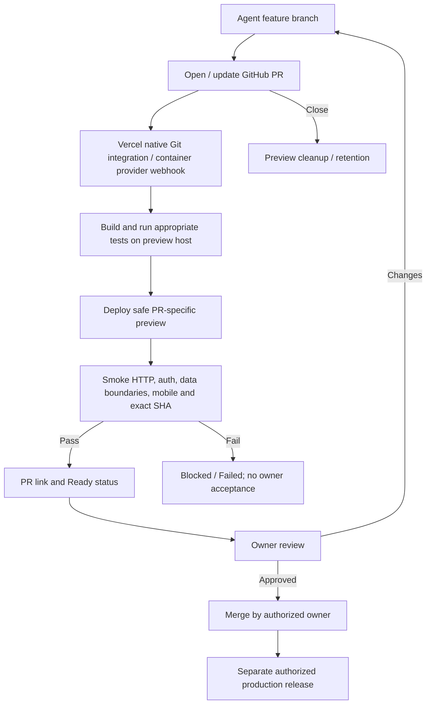

# Headspace / Skipt — Universal PR Preview Standard (Vercel-first)

**Policy status:** proposed common standard; pilot implementation exists in a draft PR. Never interpret this as production authorization or as a verified system-wide rollout. Canonical SAAS architecture and each application's guards remain authoritative.

## Standard development lifecycle

Use **Vercel native Git PR previews by default** for compatible React/Next/Vite/static apps. GitHub still hosts the repository and pull requests, but **no GitHub Actions job is needed for preview deployment**. Vercel runs builds/checks and links deployments to commits. Vercel usage and plan limits still apply.

Long-running services, WebSocket backends, databases, print queues and external workers **must not be forced into a static Vercel project**. Prefer containerized per-PR environments or hybrid Vercel frontend + isolated container backend, using already-authorized infrastructure. Do not migrate production only to obtain previews.

## Required preview record

- Actual `previewUrl` (stable per PR/branch where provider supports it), exact `prNumber`, `commitSha`.
- `status`: Building / Ready / Failed / Removed, and `environment=preview`.
- Synthetic test data only. Safe role-specific test accounts delivered securely when applicable.
- Recorded check results (unit, typecheck, integration, browser, migrations, auth, security) according to risk and app type.
- Known limitations and `ownerAcceptance` Pending / Approved / Changes Requested.
- A URL is **not Ready** until it passes real network smoke and exact SHA checks.

## Isolation policy

1. Never connect previews to production DBs, finance vaults, payments, payroll, real Loyverse writes, live SMS/email or shipping.
2. Use dedicated per-PR DB/schema with **independent credentials** for backend previews. Synthetic fixtures never contain real personal or financial data.
3. Disable side-effect adapters, scheduled background workers, POS sync and external notification delivery by default.
4. Protect private apps with Vercel deployment protection or equivalent identity gate. A synthetic static public-safe Atlas is the **only** public exception in this pilot.
5. Never put secrets or test-account credentials in client bundles, public GitHub PRs or logs.
6. Production release requires its normal approvals; PR creation does not authorize merge or production deployment.
7. Ensure known recurring costs and automated cleanup/retention policy before enabling new paid resources.

## App preview method and rollout status

| App | Actual repository | Architecture evidence | Recommended preview | Status |
|---|---|---|---|---|
| Skipt Ordering + Headspace Ordering | `redd1975/headspace-ordering` | Node 22+, PostgreSQL, separate deployments; image-build action on main | Containerized API+DB; Vercel frontend optional (hybrid) | Audited; pending |
| People | `redd1975/headspace-hr-` | Node/TS service, Dockerfile | Isolated container+DB and synthetic payroll | Audited; pending |
| Till | `redd1975/headspace-till` | Go + Docker; POS guard | Isolated container and fake Loyverse/Till adapters | Audited; pending |
| Membership | `redd1975/headspace-membership` | Node/TS; Fly/Render manifests | Isolated container+DB or hybrid | Audited; pending |
| Finance | `redd1975/financial-stewardship` | React/Vite/Dexie; guarded main deploy workflow | **Vercel Git Preview**, fake vault and cloud adapter | Audited; pending |
| Finance Atlas | `redd1975/headspace-finance-atlas` | Static HTML; existing public GitHub Pages publishing | **Vercel native Git Preview** with synthetic fixture | Pilot draft PR, Git connection pending |
| Inventory | `redd1975/headspace-inventory` | Node + Docker | Container/hybrid | Discovery only |
| Recipes | `redd1975/headspace-recipes` | Python + Docker | Container | Discovery only |
| Purchasing | `redd1975/purchasing` | `main` has README only | Determine deployable branch first | Blocked |
| SAAS | `redd1975/SAAS` | Canonical policies, foundation | CI contract/tests, no user-facing app yet | Discovery |

Production domains were provided by Owner; Vercel linking to those production sites is not verified and must not be inferred.

## First pilot: Atlas

- Repository: `redd1975/headspace-finance-atlas`.
- Draft PR: `https://github.com/redd1975/headspace-finance-atlas/pull/2`.
- Dedicated Vercel project: `headspace-atlas-pr-preview` in team Xpace.
- `vercel.json` calls `preview/vercel-build.sh`: checks preview environment, PR number, SHA; runs synthetic unit tests, builds isolated fixture, verifies the manifest and mobile viewport.
- A manual API deployment of the synthetic static site returned HTTP 200 for HTML, manifest and fixture with matching PR #2 and exact commit SHA. This does not demonstrate PR-triggered auto deployment.
- **Blocker:** Vercel account reports no GitHub Login Connection. Owner must connect GitHub in Vercel Account Settings → Git, then link/import the pilot repo to the dedicated Vercel project.
- No GitHub Actions preview workflow is introduced. Vercel Git integration can post PR deployment status once connected.
- **Remaining gap:** automatic PR-close cleanup not verified. Document retention, and if immediate cleanup is mandatory, add a **scoped GitHub webhook → isolated cleanup service** without GitHub Actions, or require authorized manual cleanup. The helper `preview/cleanup.py` is not automatically invoked in this pilot.

## After Git connection: acceptance tests

1. On a new PR commit, confirm Vercel build starts with no GitHub Actions preview job.
2. Verify Vercel PR check/URL, exact PR number + SHA manifest, mobile layout, synthetic data, and no external side effects.
3. Push update; confirm same PR's preview is refreshed.
4. Close a disposable test PR; verify configured preview cleanup/retention and no production changes.
5. Prove that fork PRs do not expose secrets, Vercel build refusal covers non-PR/production builds, and preview access restrictions work for private apps.
6. Once verified, apply reusable pattern repository by repository without changing existing production infrastructure.

## Approval

Developer may audit and write development branches and draft PRs. Owner approves paid infrastructure, secrets, review/merge requirements, production DNS and release actions. No automatic merging or production changes are authorized.
