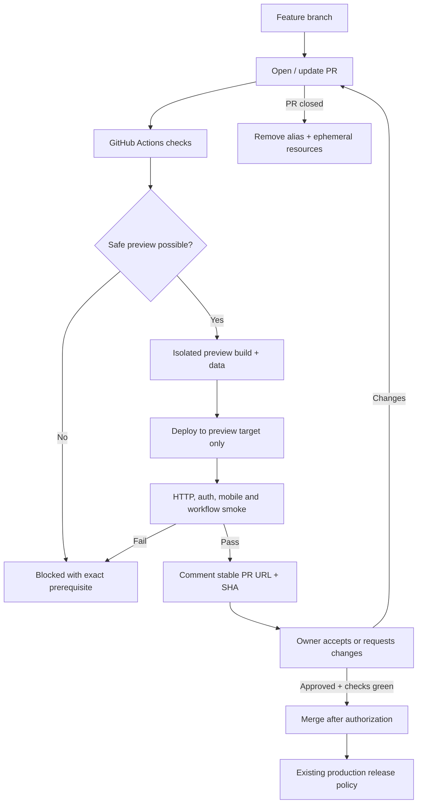

# Headspace / Skipt Universal PR Preview Standard — v1 (pilot)

Status: **first implementation slice in review**, not a platform-wide release.
Authority: the canonical SAAS architecture and each repository's existing safety rules take precedence.

## Required contract (any deployable preview)

Every PR produces a preview record with:

- `previewUrl` (HTTP smoke verified), `prNumber`, exact `commitSha`
- `status`: building, ready, failed, removed
- `environment=preview`, `testData=synthetic`
- `ci`: unit, typecheck/build, integration, browser smoke, migration and auth checks when applicable
- `testAccounts`: safe credentials through a secure channel, never in public PR comments
- `knownLimitations`, `ownerAcceptance`: pending, approved, changes requested

Ready means **actual URL reachable, exact commit marker matches, startup succeeds, required checks pass, and preview is isolated**. A build success alone is not Ready. Owner approval controls merge; merge never approves a production deployment.

## Standard lifecycle

## Practical hosting selection

| Application | Actual repo | Known runtime/evidence | Preview recommendation | Rollout status |
|---|---|---|---|---|
| Skipt Ordering and Headspace Ordering | `redd1975/headspace-ordering` | Node >=22, PostgreSQL; separate deployment modes; Skipt image built by GH Action; live Skipt host documented | **C**, per-PR isolated container + PostgreSQL for backend, protected frontend | Audit completed, implementation pending |
| People | `redd1975/headspace-hr-` | TypeScript Node and Dockerfile | **B** isolated container + DB, mail sandbox, mock payroll outputs | Audit completed, pending |
| Till | `redd1975/headspace-till` | Go service, Dockerfile, Loyverse guard | **B** isolated container, fake receipt and shift adapters | Audit completed, pending |
| Membership | `redd1975/headspace-membership` | Node/TS and Dockerfile, fly/render config | **B/C** isolated service or hybrid, fake identity/payment adapters | Audit completed, pending |
| Finance | `redd1975/financial-stewardship` | Vite, React, Dexie; real live host via guarded deployment workflow | **A** protected static synthetic app; no real vault/cloud credentials | Audit completed, pending |
| Inventory | `redd1975/headspace-inventory` | Node app, Dockerfile | **B** isolated container | Discovery only |
| Recipes | `redd1975/headspace-recipes` | Python and Dockerfile | **B** isolated container | Discovery only |
| Purchasing | `redd1975/purchasing` | `main` currently contains README only | No runnable preview until deployable branch is confirmed | Blocked |
| SAAS / Xpace core | `redd1975/SAAS` | Architecture foundation and CI | Contract/test preview, not a public product UI | Discovery only |
| Finance Atlas (public-safe tracker) | `redd1975/headspace-finance-atlas` | Static HTML, GitHub Pages publishing on main | **A**, isolated dedicated Vercel project, synthetic PR data | **Pilot implementation in this PR** |

**A** = Vercel static/frontend. **B** = container preview. **C** = hybrid.

Known production domains are not proof of linked Vercel projects. Current Vercel team project discovery returned only the newly created demo and pilot projects; existing applications should not be migrated just to run previews.

## Security requirements

1. PR deployment targets may never reference a production DB, account, hostname, or integration credential. Never read production data into sanitized preview: generate wholly synthetic fixtures.
2. Runtime preview modes enforce feature flags **on the server**; payout, payment, Loyverse writes, staff notifications, webhook delivery, jobs and shipping adapters must use disabled or synthetic implementations.
3. External PRs get no deployment secrets. Do not use `pull_request_target` to execute untrusted PR code with secrets.
4. Private app previews require access control and per-PR DB/schema with isolated credentials; public preview is allowed only for explicitly public-safe Atlas content.
5. Deployments must be bound to exact PR+SHA; enforce a stable per-PR URL and a smoke-check before commenting Ready.
6. A PR close must remove aliases, preview deployments, test DBs and disposable credentials. Cleanup must be restricted by project/team/PR metadata; never delete unrelated resources.
7. GitHub Actions must never reuse existing production deployment workflows or trigger production on PR open. In particular, do not enable `--prod`, merge, live migrations or production restart.
8. Secure tokens live only in GitHub Actions Secrets/host secret manager and are not printed in workflow logs.
9. Fail closed when credentials, data isolation or external sandbox setup cannot be verified.
10. Existing app-specific governance, source-of-truth, privacy, design locks and branch policies remain in force.

## Minimal adoption procedure

1. Read repo `AGENTS.md`, `CLAUDE.md`, policy pin and deployment workflow. Document production write routes and find exactly how production deploys.
2. Select A/B/C and define per-PR cost/resource caps and isolation boundaries.
3. Add isolated preview build config, health endpoint, synthetic fixture and auth test roles.
4. Add GitHub Actions `pull_request` workflow to build+test+deploy to a **dedicated preview project/service**.
5. Protect previews, smoke-test the exact SHA and post one stable PR comment.
6. Add a `closed` cleanup path and test it on an actual preview.
7. Require preview check and owner acceptance through normal branch protection only after explicit policy approval.
8. Preserve independent merge and production release approval.

## Atlas pilot-specific boundary

The public Atlas site is already a sanitized read-only status tracker. Its preview is *not* the real Finance application, and may not expose private Finance pull requests. Its new PR workflow always substitutes a fixed synthetic fixture and never pulls production data. It deploys to a separate Vercel project, leaving the GitHub Pages main-branch publishing workflow unchanged.

The dedicated Vercel project was created on the existing Xpace Hobby team. The first step to full automation is a repository-scoped CI token `ATLAS_PREVIEW_VERCEL_TOKEN`. GitHub→Vercel automatic Git linking is unavailable because this Vercel account reports no GitHub Login Connection; the workflow uses the CLI instead.

## Follow-on proof required

- Open a PR; verify Github Actions triggered and authenticated Vercel deploy succeeded.
- Verify URL and exact SHA; push a commit and verify unchanged alias with updated SHA.
- Close a **throwaway** PR, verify alias 404 and no PR deployments remain.
- Verify a fork PR cannot access deployment secrets.
- Rehearse a failed build and missing token: no Ready comment and no production changes.
- Owner review and merge only after passing evidence; production release remains separate.
